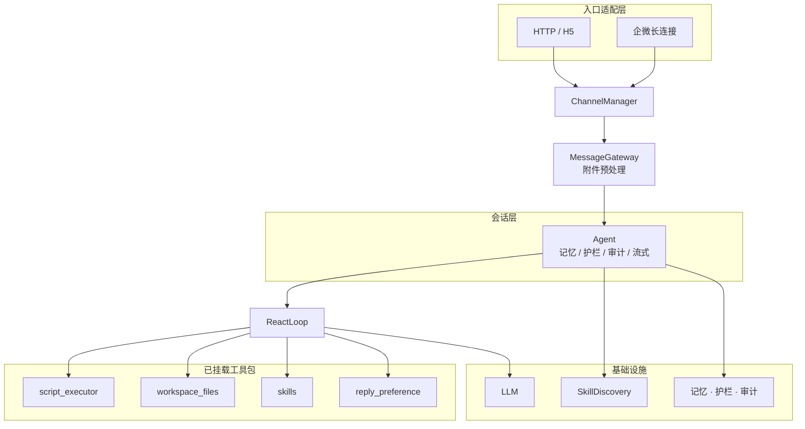

# 架构图

单 Agent + 全工具 + Skill 注入。一个进程只有一个 Agent、一份系统提示词、一份
`configs/agent.yaml` 的 `tool_packs` 列表，没有编排层与领域派发。

---

## 1. 分层总览



`configs/tool_packs.yaml` 另定义了 `excel_tools` / `web_search` / `http_request` /
`mcp` / `search` / `todo` 五类工具包，当前未列入 `configs/agent.yaml`，因此不挂载。

## 2. 请求路径

```
用户消息
  → MessageGateway（@提及剥离、附件转文本、并发闸门 chat.max_concurrent_requests）
  → Agent（输入护栏 → 记忆加载 → 预算分配 → 上下文组装）
  → ReactLoop（LLM function calling → 工具 → 结果回灌）
  → Skill 索引常驻 system prompt，正文由模型调 load_skill 取
  → 流式 delta → 输出护栏 → 记忆回写 → 审计落盘
```

流式事件类型：`progress` / `reasoning` / `delta` / `final` / `error`。
企微通道把 `delta` 累积成增量消息（`finish=false` … `finish=true`）。
